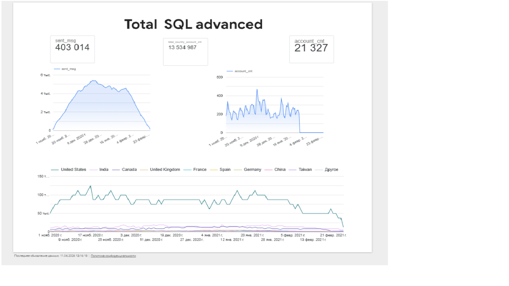

# sql-portfolio
SQL projects demonstrating data analysis skills using SQL queries.
# SQL — Аналіз активності користувачів та email-комунікацій

## Мета проєкту
Аналіз активності користувачів та ефективності email-комунікацій у різних країнах.

## Що було зроблено
- Розраховано кількість унікальних акаунтів.
- Підраховано кількість надісланих, відкритих та відвіданих email-повідомлень.
- Об'єднано дані з різних таблиць за допомогою `UNION ALL`.
- Розраховано загальні показники по країнах.
- Сформовано рейтинги країн за кількістю акаунтів і надісланих повідомлень.
- Відібрано 10 найкращих країн за кожним показником.

## SQL-інструменти
CTE, JOIN, LEFT JOIN, UNION ALL, COUNT(), SUM(), віконні функції, DENSE_RANK().
## Візуалізація

